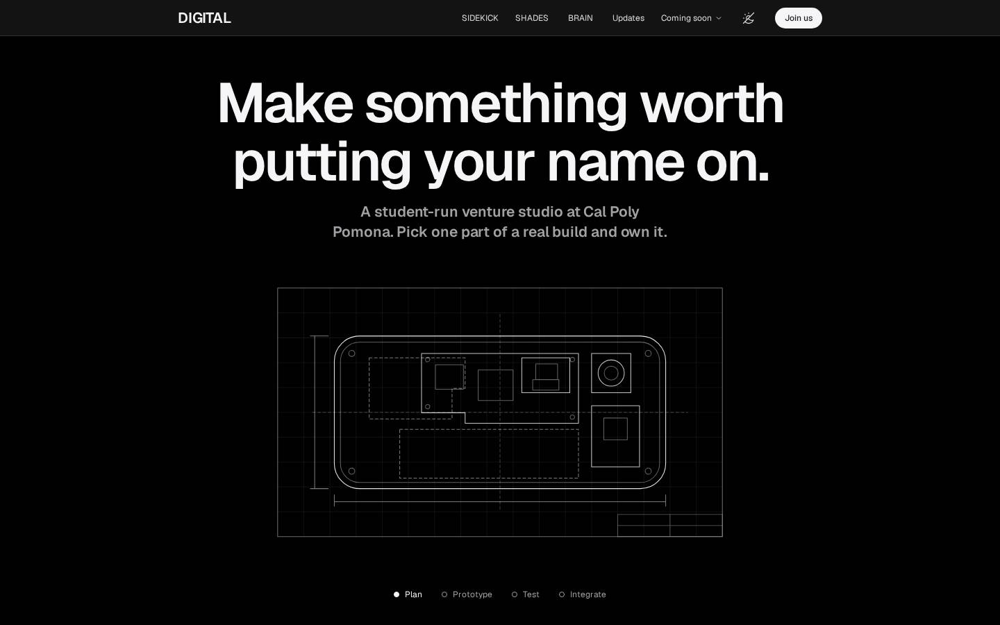
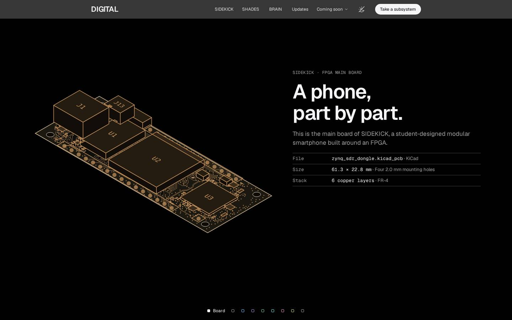
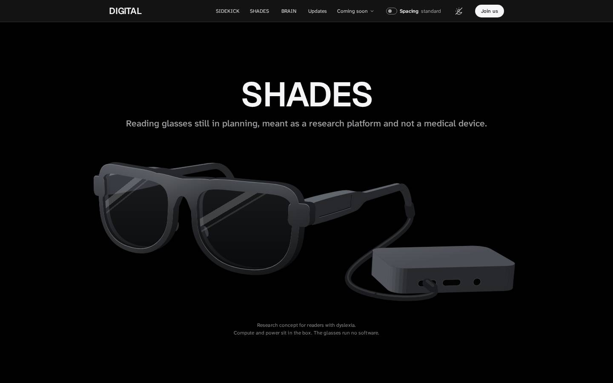
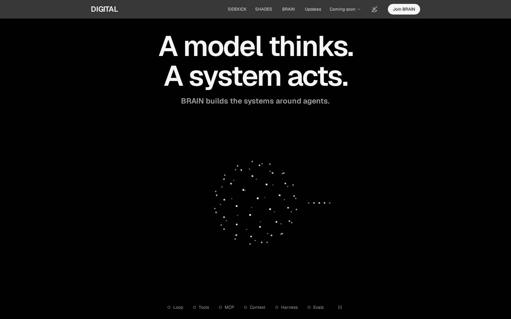
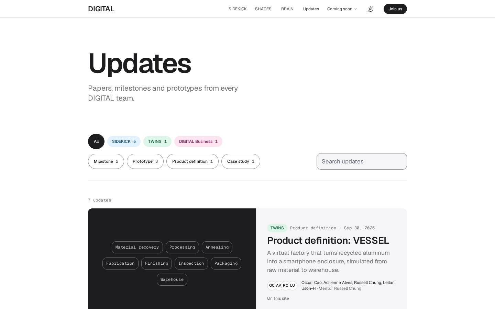
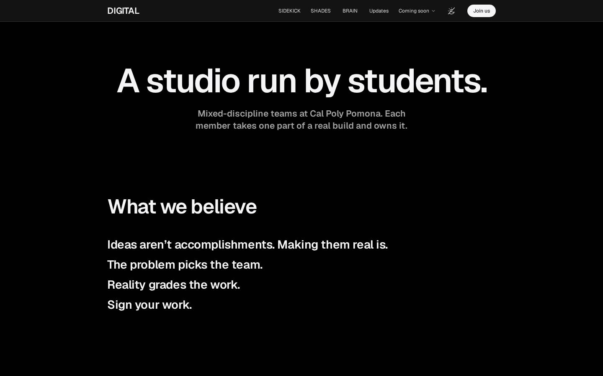
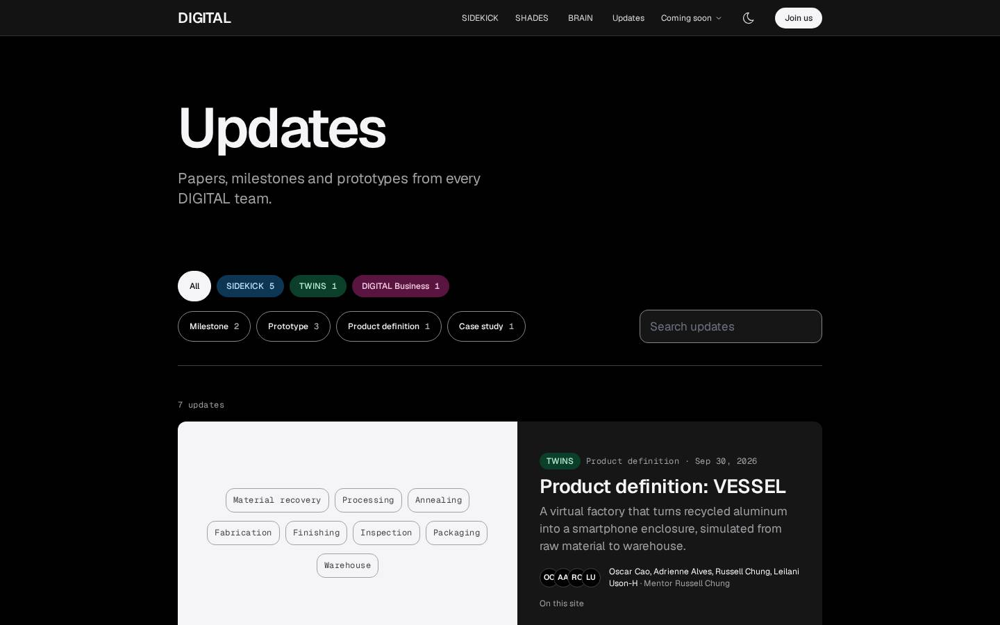
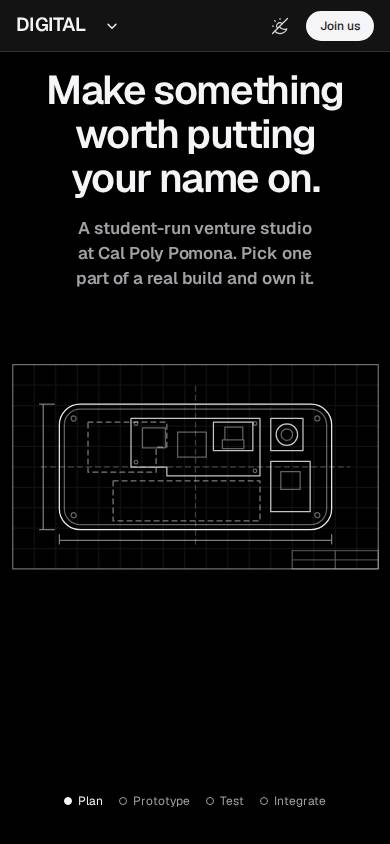

# DIGITAL @ Cal Poly Pomona Website

Official website for **DIGITAL**, a student-run venture studio at Cal Poly Pomona. Each build is
split into subsystems, and each subsystem has an owner. The site shows the builds: SIDEKICK
(a modular smartphone), SHADES (heads-up display glasses) and BRAIN (agentic AI).

**Live site:** <https://digitalcpp.vercel.app>

Next.js 16 (App Router) and TypeScript, configured for **static export** and deployed on Vercel.
The live design is the "Apple" system (default since 2026-10-07), in `app/(apple)/`. Earlier
designs are in `archive/`.

## Screenshots

Captured from production at 1440x900 (first viewport). See [Refresh the screenshots](#refresh-the-screenshots).

| | |
|---|---|
|  **Home** `/`: a phone hero that plays four stages as you scroll, then the three builds and how to join. |  **SIDEKICK** `/projects/sidekick/`: the FPGA main board in played stages (locked page). |
|  **SHADES** `/projects/shades/`: reading glasses, a live reader and light-path stages. |  **BRAIN** `/projects/brain/`: lessons on how AI agents work, on one dot figure (locked page). |
|  **Updates** `/updates/`: the team's posts, read from Supabase at build time. |  **About** `/about/`: the studio, on the shared `SitePage` frame. |
|  **Dark theme** (`/updates/`): the nav toggle offers System, Light and Dark (stored in `localStorage` key `r2-theme`). |  **Phone** (390x844): the same home page at phone width. |

## Quick start

Prerequisites: **Node.js 24.x** (`engines` in `package.json`; CI uses Node 24) and npm.

```bash
git clone https://github.com/BrooklynD23/DIGITAL_WebsiteV1.git
cd DIGITAL_WebsiteV1
npm ci
./run.sh          # preflight checks, then the dev server on http://localhost:3000
./run.sh check    # preflight checks only (TypeScript, lint, critical files, routes); run before committing
./run.sh build    # preflight checks, then a production static export to out/
```

`./run.sh check` blocks on TypeScript errors; lint problems are only warnings in the script, but
CI runs `npm run lint` and blocks on it. `npm run test:updates` runs the Updates data-source
tests (CI does not run them).

## Tech stack

Versions are from `package.json` ranges and `package-lock.json`.

| Part | Choice | What it does here |
|------|--------|-------------------|
| [Next.js](https://nextjs.org/docs) 16.4 | App Router, `output: 'export'` | Static site; `next build` writes `out/` |
| [React](https://react.dev) 19.3 | UI | Pages and components |
| [TypeScript](https://www.typescriptlang.org/docs/) 5.9 | `strict: true` | `tsc --noEmit` in CI and `run.sh` |
| [ESLint](https://eslint.org/docs/latest/) 10 + `eslint-config-next` | `npm run lint` (`app`, `lib`) | Lint |
| CSS modules | `--r2-*` tokens in `app/(apple)/_system/tokens/worlds.css` | All styling. No Tailwind, no CSS-in-JS. A plain-CSS reset lives in `app/globals.css` |
| [Anime.js](https://animejs.com/documentation/) 4.5 | Stage playback | Timed tweens for pinned pages (`useStagePlayback.ts`) |
| [Tabler Icons](https://tabler.io/docs/icons/react) (`@tabler/icons-react` 3.48) | Icon set | Nav, theme toggle, footer, SIDEKICK reel |
| Fonts via `next/font/local` | Geist, Geist Mono, Atkinson Hyperlegible Next, Hubot Sans, Mona Sans, Monaspace Krypton | Self-hosted, SIL OFL 1.1; `app/(apple)/_system/fonts/index.ts` |
| [Playwright](https://playwright.dev/docs/intro) 1.63 (dev) | Headless browser | Screenshots and design-lab scripts |
| [sharp](https://sharp.pixelplumbing.com/) 0.35 (dev) | Image encoding | `npm run encode:teardown` |

## Services and deployment

```
feature branch --PR--> main --CI green--> deployment --> Vercel production
```

1. **CI** (`.github/workflows/ci.yml`) runs on every pull request and push to `main`: `npm ci`, `scripts/validate-vercel-json.mjs`, `npx tsc --noEmit`, `npm run lint`, `npm run build`.
2. **Promote** (`.github/workflows/promote-deployment.yml`) runs when CI succeeds on `main` and fast-forwards the `deployment` branch to that commit. A diverged `deployment` makes it fail.
3. **Vercel** deploys production from the `deployment` branch only. Details: [`docs/DEPLOYMENT.md`](docs/DEPLOYMENT.md).
4. **Vercel Analytics and Speed Insights** (`@vercel/analytics`, `@vercel/speed-insights`) are mounted in `app/layout.tsx`.
5. **Supabase** holds the Updates posts: table `digital_posts`, storage bucket `digital-updates`. The site reads them **at build time** (`lib/data/updates-source.ts`), so an edit goes live on the next build. With no env vars the build falls back to the committed `UPDATES` snapshot. Editor how-to: [`supabase/README.md`](supabase/README.md).
6. **Keep-alive** (`.github/workflows/supabase-keepalive.yml`) runs daily at 09:17 UTC and on demand: it reads `digital_posts`, uploads the result as an artifact and, if `VERCEL_DEPLOY_HOOK_URL` is set, triggers a Vercel deploy.
7. **Formspree** is the contact form endpoint, set in `lib/data/siteConfig.ts`. It is still a placeholder, so the form cannot submit yet.
8. **Discord** is linked from the site (`lib/data/siteConfig.ts`, footer). No bot or webhook.

Environment variable **names** (set values in GitHub Actions secrets, Vercel and a local `.env.local`; never commit them):

| Name | Used for |
|------|----------|
| `SUPABASE_URL`, `SUPABASE_PUBLISHABLE_KEY` | Reading Updates at build time (CI, Vercel, local) |
| `VERCEL_DEPLOY_HOOK_URL` | Optional, keep-alive workflow only |
| `NEXT_PUBLIC_SITE_URL` | Optional site URL override (defaults to `siteConfig.url`) |

## Repo map

```
app/(apple)/            Live pages (route group; not part of the URL)
  _system/              Tokens, fonts, scroll hooks, dot engine, shared UI
  _chrome/              LocalNav, WorldFooter, JoinChapter, SitePage, ThemeToggle, club.ts
  _content/             Copy for the Apple pages
  projects/             _hero/ (home artwork, useStagePlayback), sidekick/, shades/, brain/
  updates/              /updates/ and /updates/[slug]/
lib/data/               Club facts, team, involvement, community, updates source
supabase/               Table migration and the editor how-to
scripts/                Build helpers (update assets, vercel.json check)
public/                 Static assets
docs/                   Documentation hub, specs, brand guide, README screenshots
archive/                Earlier designs; not built, linted or type-checked
design-lab/             Research, renders and scripts from the redesign
.github/workflows/      ci, promote-deployment, supabase-keepalive
run.sh                  Preflight and dev/build launcher
```

## Documentation index

| Doc | What it is |
|-----|-----------|
| [`CLAUDE.md`](CLAUDE.md) | Project conventions, key files, standing rules |
| [`AGENT.md`](AGENT.md), [`AGENTS.md`](AGENTS.md) | Pointers to `CLAUDE.md` for automated agents (`AGENTS.md`: the 3 most-missed rules) |
| [`DESIGN.md`](DESIGN.md) | The Apple design system as implemented: tokens, patterns, changelog |
| [`PRODUCT.md`](PRODUCT.md) | Product brief: audience, purpose, principles |
| [`docs/README.md`](docs/README.md) | Documentation hub |
| [`docs/ROUTES.md`](docs/ROUTES.md) | Route map: live, redirect stubs, retired |
| [`docs/WBS.md`](docs/WBS.md) | Standardized WBS task pipeline behind the home hero's four stages |
| [`docs/DEPLOYMENT.md`](docs/DEPLOYMENT.md) | CI/CD and Vercel setup |
| [`docs/design/BRAND.md`](docs/design/BRAND.md) | Voice and copy rules for every route |
| [`docs/design/sidekick.DESIGN.md`](docs/design/sidekick.DESIGN.md) | SIDEKICK page spec (locked) |
| [`docs/design/brain.DESIGN.md`](docs/design/brain.DESIGN.md) | BRAIN page spec (locked) |
| [`docs/design/`](docs/design/) | Also holds specs of archived designs, history only |
| [`docs/PRE-LAUNCH.md`](docs/PRE-LAUNCH.md) | Launch items that cannot be set in the repo |
| [`docs/MAINTAINER_GUIDE.md`](docs/MAINTAINER_GUIDE.md) | Content and config how-to (some sections describe retired pages) |
| [`docs/troubleshooting/KNOWN_ISSUES.md`](docs/troubleshooting/KNOWN_ISSUES.md) | Dev and build troubleshooting |
| [`TODO.md`](TODO.md) | Work log and Dev Build / Version Control table |
| [`supabase/README.md`](supabase/README.md) | How to add or edit Updates posts |
| [`archive/README.md`](archive/README.md) | Index of archived designs and code |
| [`design-lab/`](design-lab/) | Redesign research, critiques, handoffs and capture scripts |

## How to contribute

1. **One worktree per task**, branched from `origin/main`: `git worktree add -b <branch> ../<dir> origin/main`.
2. **Read the governing doc first** (table in `CLAUDE.md`). Changes beyond token-faithful tweaks need Head Designer approval before you build them.
3. **Locked pages** (`/projects/sidekick/`, `/projects/brain/`) change only with Head Designer sign-off. They also depend on shared code (`_system`, `_chrome`, `useStagePlayback.ts`); re-check them after touching it.
4. **Copy** lives in `app/(apple)/_content/`, `_chrome/club.ts` and `lib/data/`, never in components. Read `docs/design/BRAND.md`; write copy with the `brand-voice-strategist` agent and review it with `brand-guardian` before committing.
5. **Run `./run.sh check`**, open a pull request, and merge only after CI passes.
6. **Keep `TODO.md` in sync**: every commit gets a build-number row (`lab.N`, `#NNNN`, SHA, message) in the Dev Build / Version Control table, docs-only commits too.
7. Static export only: no server-only Next.js features.

## For the next maintainer

<!-- TODO(maintainer): fill in the sections below; no repo source states them. -->

### Current maintainers and leads
<!-- TODO(maintainer): names and roles of the current leads, and who holds Head Designer sign-off. -->

### Contact
<!-- TODO(maintainer): the club's preferred contact route for site issues. -->

### Roadmap
<!-- TODO(maintainer): next planned work. Known open items: the Formspree endpoint is a placeholder; the team roster is not final. See the TODO.md backlog. -->

### Refresh the screenshots

```bash
npm ci
npx playwright install chromium                      # once
node docs/readme/capture.mjs                         # captures https://digitalcpp.vercel.app
node docs/readme/capture.mjs http://localhost:3000   # or another base URL
```

The script writes the eight JPEGs in `docs/readme/` (1440x900 first viewport, phone at 390x844).
Keep each under 250 KB. The Dark shot uses `/updates/` because the home hero is already dark in
the default theme.

## License and ownership

<!-- TODO(maintainer): no LICENSE file or license field exists in the repo. Add one, or state ownership here. -->

Maintained by DIGITAL @ Cal Poly Pomona.
